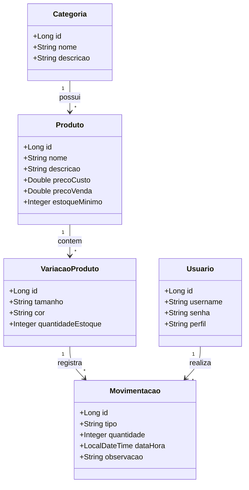
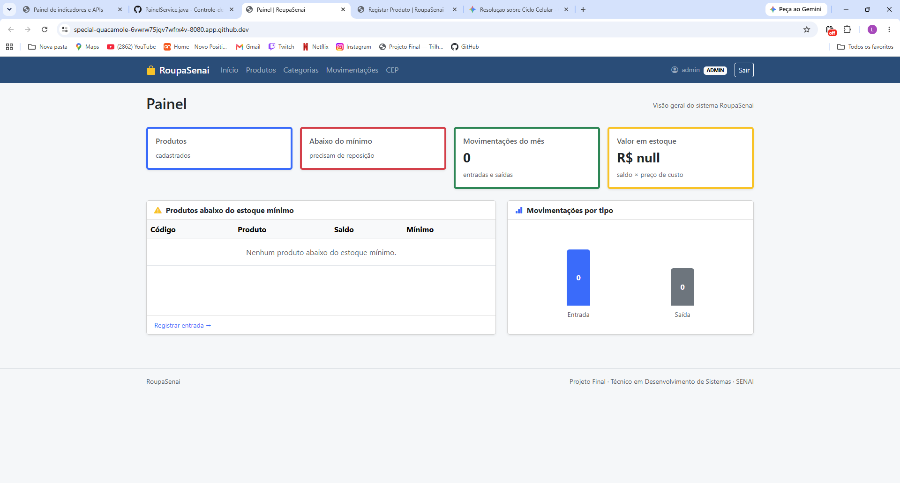
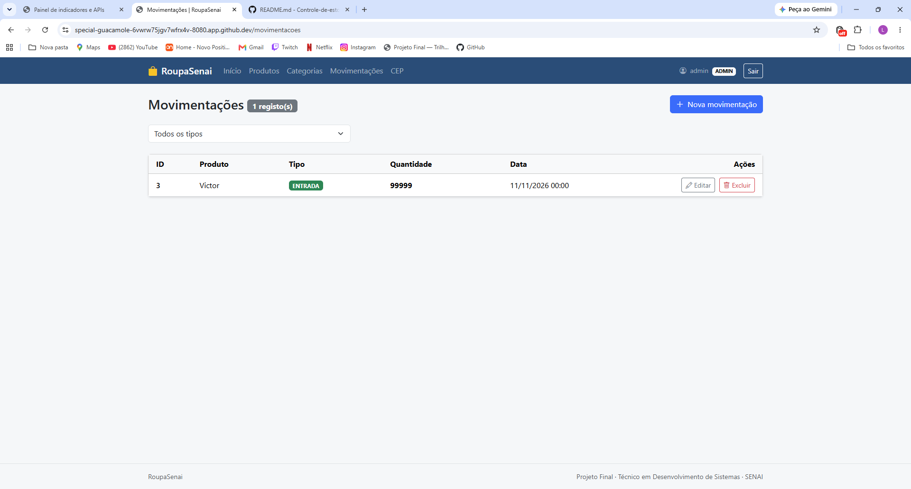
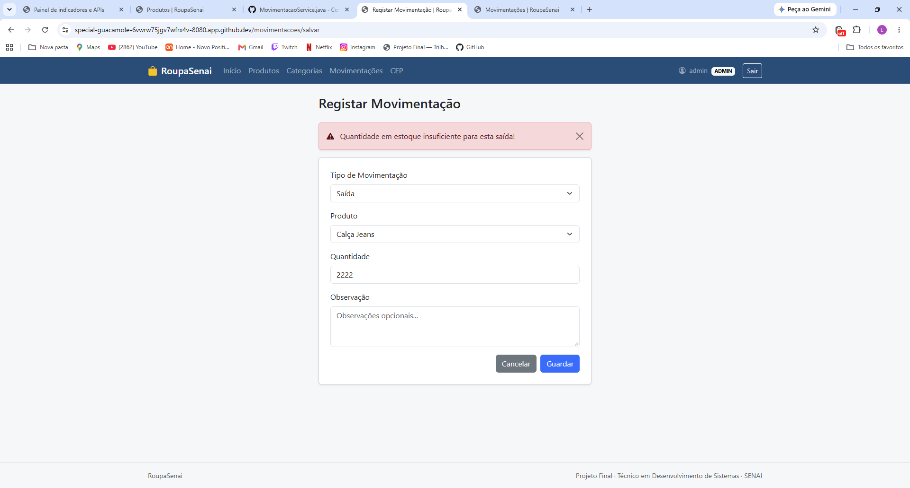
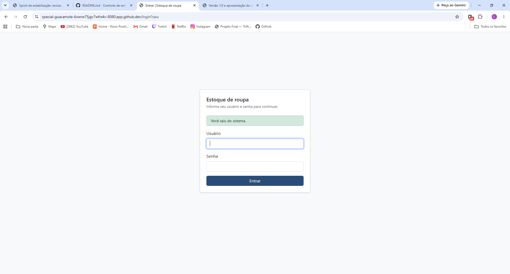

# Estoque de roupa

> Este README e o **documento de visao** do projeto (entrega **AVA 1**) e, ao longo do curso,
> tambem sera o manual tecnico de como executar o sistema.

| | |
|---|---|
| **Aluno(a)** | Luis fernando Langame Alegro |
| **Turma** |TEC-N-001788/2026 |
| **Opcao escolhida** | Controle de Estoque |
| **Versao atual** | 0.1.0 |

---

## 1. Visao geral

### 1.1 Problema
O controle de estoque em muitas lojas de roupas de pequeno e medio porte ainda e feito de forma manual em planilhas desatualizadas ou ate mesmo no papel. Isso gera divergencias frequentes entre o estoque fisico e o virtual, perdas por falta de produtos procurados pelos clientes (ruptura), dificuldades no controle por variacao de tamanho e cor, e falta de visibilidade sobre os produtos mais vendidos.

### 1.2 Canvas do projeto

| Bloco | Resposta |
|---|---|
| **Usuarios** (quem usa o sistema) | Estoquistas, Vendedores e Gerentes da loja de roupas. |
| **Problema** (dor atual) | Dificuldade em controlar tamanhos e cores, perdas de itens, falta de agilidade na reposicao e divergencia de inventario. |
| **Proposta de valor** (o que melhora com o sistema) | Controle automatizado em tempo real do estoque por tamanho/cor, agilidade nas entradas/saidas e relatorios precisos de inventario. |
| **Funcionalidades principais** | Cadastro de produtos (com atributos como cor e tamanho), registro de entradas e saidas, controle de categorias, emissao de alertas de estoque baixo e relatorios de movimentacao. |
| **Informacoes que o sistema guarda** | Produtos, Categorias, Tamanhos, Cores, Fornecedores, Movimentacoes de Estoque (Entradas e Saidas), Usuarios e Perfis de Acesso. |
| **Indicadores** (o que o gestor quer acompanhar) | Giro de estoque, produtos com estoque critico/baixo, volume de vendas/saidas por periodo e produtos mais vendidos. |
| **Restricoes** (prazo, tecnologia, equipe) | Projeto individual · Java 21 · Spring Boot 4 · entrega v1.0 em 11/11. |

---

## 2. Requisitos

### 2.1 Requisitos funcionais (o que o sistema FAZ)

| ID | Requisito | Nivel |
|---|---|---|
| RF01 | O sistema deve permitir cadastrar, listar, editar e excluir categorias de roupas (ex.: Camisetas, Calcas, Vestidos). | Essencial |
| RF02 | O sistema deve permitir cadastrar, listar, editar e excluir produtos informando nome, descricao, preco de custo, preco de venda e categoria. | Essencial |
| RF03 | O sistema deve permitir gerenciar as variacoes de produtos por tamanho (PP, P, M, G, GG) e cor. | Essencial |
| RF04 | O sistema deve registrar entradas de estoque (compra de fornecedores ou devolucoes) atualizando a quantidade do item correspondente. | Essencial |
| RF05 | O sistema deve registrar saidas de estoque (vendas ou perdas) dando baixa na quantidade do produto. | Essencial |
| RF06 | O sistema deve emitir alertas visuais no painel para produtos com estoque abaixo do limite minimo configurado. | Importante |
| RF07 | O sistema deve gerar relatorios de movimentacao de estoque por periodo. | Desejavel |

### 2.2 Requisitos nao funcionais (COMO o sistema deve ser)

| ID | Requisito |
|---|---|
| RNF01 | O sistema deve ser acessado pelo navegador (aplicacao web). |
| RNF02 | O sistema deve exigir login e senha; as senhas devem ser armazenadas criptografadas. |
| RNF03 | O sistema deve ser responsivo, permitindo o uso basico via navegadores de dispositivos moveis. |
| RNF04 | O tempo de resposta para listagens e buscas no estoque nao deve superar 3 segundos em condicoes normais de uso. |

### 2.3 Regras de negocio (as REGRAS do negocio que o sistema precisa respeitar)

| ID | Regra |
|---|---|
| RN01 | Nao e permitido registrar uma saida de estoque maior do que a quantidade fisica disponivel para aquele tamanho/cor do produto. |
| RN02 | O preco de venda de um produto nao pode ser inferior ao seu preco de custo. |
| RN03 | Apenas usuarios com perfil de Administrador podem excluir produtos ou categorias ja movimentados. |
| RN04 | O estoque minimo de um produto nao pode ser definido com valor negativo. |

---

## 3. Historias de usuario

Formato: **Como** *[papel]*, **quero** *[acao]*, **para** *[beneficio]*.

**HU01 —** Como gerente de estoque, quero cadastrar novos modelos de roupas informando suas variacoes de cor e tamanho, para que o catalogo esteja sempre atualizado.
- Criterio de aceite: Deve ser possivel selecionar multiplas cores e tamanhos ao cadastrar um produto.
- Criterio de aceite: O sistema impede o cadastro de produtos sem preco de custo ou venda definidos.

**HU02 —** Como operador de estoque, quero registrar a entrada de novas mercadorias compradas de fornecedores, para atualizar automaticamente o saldo disponivel.
- Criterio de aceite: Informar a quantidade recebida por variacao (ex: 10 unidades da Camiseta Azul tamanho M).
- Criterio de aceite: A data da entrada deve ser registrada automaticamente.

**HU03 —** Como vendedor, quero registrar a saida de itens vendidos no balcao, para que o estoque reflita a realidade da loja imediatamente.
- Criterio de aceite: O sistema deve bloquear a saida se a quantidade solicitada for maior que o estoque atual (Regra RN01).
- Criterio de aceite: O sistema exibe mensagem de sucesso e atualiza o saldo na tela de listagem.

---


## 4. Modelo de dados



## Usuários de Teste

| Usuário | E-mail / Login | Senha | Perfil | Permissões |
| :--- | :--- | :--- | :--- | :--- |
| **Administrador** | `admin@sistema.com` | `admin123` | ADMIN | Acesso total (Cadastrar, editar, excluir e movimentar) |
| **Luis Fernando** | `luis@sistema.com` | `user123` | OPERADOR | Apenas consulta e registro de movimentações |

## 5. Como executar

### No GitHub Codespaces (recomendado)
1. No repositório, clique em **Code → Codespaces** e abra o Codespace existente (ou **Create codespace on main**).
2. No terminal, execute:
   ```bash
   mvn spring-boot:run
   ```
3. Aguarde a mensagem `Started SistemaApplication` no terminal.
4. Abra a aba **Portas** (ao lado do Terminal) e, na linha da porta **8080**, clique no ícone de globo (**Abrir no navegador**).
5. Entre com um dos usuários da seção **Usuários de teste**.

### No computador (ferramentas instaladas)
Requisitos: JDK 21 e Maven (ou uma IDE com suporte a Java, como IntelliJ IDEA ou VS Code com o *Extension Pack for Java*).
Na pasta do projeto, execute `mvn spring-boot:run` e acesse `http://localhost:8080`.

### Banco de dados de desenvolvimento
- O banco H2 fica na pasta `dados/` (não vai para o GitHub). Na primeira execução, o sistema cria as tabelas e os dados de exemplo.
- Para recomeçar com os dados de exemplo: pare o sistema e apague a pasta (`rm -rf dados`).
- Console do banco: endereço `/h2-console` (só para o perfil ADMIN).

## 6. Tecnologias
Java 21 · Spring Boot 4 · Spring MVC · Thymeleaf · Bootstrap 5 · Spring Data JPA · H2 (desenvolvimento) · MySQL (produção) · Spring Security · Git/GitHub

## 7. Uso de inteligência artificial
Para fins didaticos

## 8. Histórico de versões
| Versão | Data | Descrição |
|---|---|---|
| 0.1.0 | | Projeto inicial criado a partir do repositório modelo |

## 9. Funcionalidades e telas

### Funcionalidades
- Cadastro de produtos e categorias.
- Registro de entradas e saídas, com atualização automática do saldo.
- Alerta de produtos abaixo do estoque mínimo.
- Painel com os indicadores do estoque.
- Login com dois perfis: o Administrador pode tudo; o Operador consulta produtos e categorias e registra movimentações.

### Telas

**Painel com os indicadores do estoque**



**Movimentações de entrada e saída**



**Regra de negócio: saída maior que o saldo**



**Tela de login**



## 10. Checklist do nível essencial

- [x] O sistema sobe sem erros seguindo a seção 5 (Como executar)
- [x] Cadastro completo de produtos (cadastrar, listar, editar e excluir), com validação
- [x] Cadastro completo de categorias, com validação
- [x] Movimentações ligadas aos produtos (e produtos ligados às categorias), com lista de escolha no formulário
- [x] Regra de negócio 1: A saída não pode ser maior que o saldo do produto.
- [x] Regra de negócio 2: Alerta quando o saldo fica abaixo do estoque mínimo.
- [x] Login com 2 perfis (admin e operador), senhas criptografadas e acesso conforme o perfil
- [x] Painel com os indicadores na página inicial
- [x] Repositório no GitHub com commits frequentes
- [x] README com a visão do projeto, como executar, usuários de teste, funcionalidades e telas
- [x] Quadro Kanban atualizado